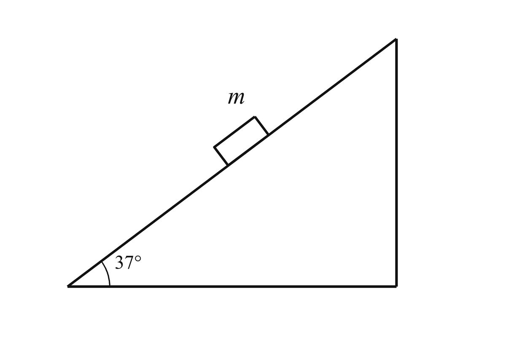
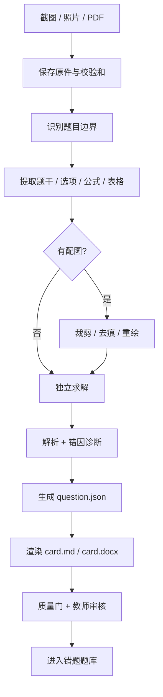

# 错题工坊 · Mistake Question Studio

> 把一张错题照片、截图或 PDF，变成一张**干净、可讲、可复习**的错题卡。

**项目名：** `mistake-question-studio`　|　**作者：** [Yujie Chen](https://github.com/Yu-Jie-Chen)　|　**仓库：** [Yu-Jie-Chen/mistake-question-studio](https://github.com/Yu-Jie-Chen/mistake-question-studio)

[](LICENSE)
[](#支持科目)
[](https://github.com/Yu-Jie-Chen/mistake-question-studio)
[](https://github.com/Yu-Jie-Chen/mistake-question-studio/actions/workflows/validate.yml)

---

## 它解决什么问题

老师整理错题时，经常遇到这些麻烦：

- 题目在照片里，边缘歪斜、光线不均；
- 图上有学生画的 $N$、$f$、$mg$、辅助线，不能直接放进讲义；
- PDF 里文字能复制，但公式、表格、选项乱了；
- 同一道题，题干、答案、解析、知识点散落在不同地方；
- 想批量整理，却每道题都要重新排版。

**错题工坊**把这件事拆成一条可重复的流水线：

```text
截图 / 照片 / PDF
      ↓
题目边界识别
      ↓
题干、选项、公式、表格提取
      ↓
配图去痕 / 裁剪 / 重绘
      ↓
独立求解 + 解析 + 错因诊断
      ↓
错题卡（Markdown / DOCX）
      ↓
质量检查 + 教师审核
```

它不绑定具体学科，也不绑定某一个 AI 工具。物理、化学、数学、英语、生物、地理、历史、政治都可以用；换学科时只加载对应的“学科适配器”。

---

## 核心特点

### 1. 先保真，再美化

不偷偷改数字、单位、选项、条件。看不清就标 `[?]`，不猜。

### 2. 把“题目”和“做题痕迹”分开

印刷题干、学生笔迹、老师批注、解题辅助线是四层信息。干净卡片只保留题目和题图本身。

### 3. 配图有明确的处理决策

不是所有图都要重画：

| 情况 | 处理 |
|---|---|
| 图清楚、没有笔迹压住线条 | 裁剪 + 校正 + 去底 |
| 笔迹只在空白处 | 蒙版擦除 + 保留原图 |
| 笔迹压住几何、透视严重、分辨率低 | 按结构重绘 |
| 图缺失或无法辨认 | 停止，向用户确认 |

重绘时先写“图形规格”（对象、连接、方向、虚实线、标签、约束），再画图；**不添加解题用的力箭头、辅助线或坐标**。

### 4. 答案必须独立求解

不抄学生答案，不把答案键当唯一依据。解析要能让学生看懂“关键判断点”，而不是只给算式。

### 5. 有审核门槛

每张卡都有 `review.md` 和质量门。未通过审核的卡只能是 `draft`，不能进入公共题库。

---

## 演示

下面是一张由本仓库示例生成的清洁配图（无 $N$、$f$、$mg$ 等做题痕迹）：



完整示例：

- [示例题目与卡片](examples/incline-static/)
- [示例 question.json](examples/incline-static/question.json)
- [示例纯题干 question.md](examples/incline-static/question.md)
- [示例 card.md](examples/incline-static/card.md)
- [示例图规格](examples/incline-static/figures/fig-1.spec.json)

> 示例是仓库自编的合成题，不来自任何教材或试卷。

---

## 快速开始

### 方式一：作为 AI Skill 使用

把整个目录放到你的 agent 能发现 skill 的位置，入口文件是 [`SKILL.md`](SKILL.md)。

```bash
git clone https://github.com/Yu-Jie-Chen/mistake-question-studio.git
```

常见位置：

| 工具 | 放置位置（示例） |
|---|---|
| DeepSeek Harness / DSH | `~/.dsh/skills/mistake-question-studio/` |
| Claude Code | `~/.claude/skills/mistake-question-studio/` |
| 其他支持 `SKILL.md` 的 agent | 按其文档放入 skills 目录 |

然后直接对 agent 说：

```text
帮我整理这道错题：提取题干，去掉图上的笔迹，重绘配图，
给出答案、解析和错因诊断，输出一张错题卡。
```

或：

```text
把这个 PDF 里的第 3—5 题整理成错题卡，物理，高中。
```

### 方式二：只用脚本

```bash
# 1) PDF 转页面图，或把照片标准化
python scripts/prepare_scan.py input.pdf work/20260101-physics-001/source --dpi 300

# 2) 裁剪 / 校正 / 去底
python scripts/clean_figure.py raw.png figures/fig-1.png \
  --crop 120,80,980,720 --rotate -1.2 --trim --max-side 2400

# 3) 有文字层的 PDF 提取文本
python scripts/extract_pdf.py input.pdf text --pages 1-3

# 4) 生成卡片（question.md 可选）
python scripts/build_card.py text/question.json \
  --out card.md --question-out text/question.md --docx card.docx

# 5) 校验
python scripts/validate_package.py text/question.json --root .

# 6) 批量索引
python scripts/build_index.py work --out work/index.md
```

核心依赖：

```bash
pip install -r requirements.txt
# 或者：pip install pillow numpy
```

可选依赖：

```bash
pip install -r requirements-optional.txt
# 或者按需安装：pymupdf pypdf python-docx pytesseract
```

`pytesseract` 还需要系统安装 Tesseract，并准备 `chi_sim`、`eng` 语言包。

> DOCX 导出会保留公式的 LaTeX 文本，不会自动转成 Word 原生公式。需要排版级公式时，可用 Pandoc 或 Word 公式编辑器做二次处理；Markdown 卡片中的 `$...$` 可直接被支持数学的渲染器识别。

---

## 工作流



详细步骤见 [`references/workflow.md`](references/workflow.md)。

---

## 支持科目

| 科目 | 重点保留 | 常见坑 |
|---|---|---|
| 物理 | 对象、方向、受力、电路、光路、单位 | 把 $N/f/mg$ 等解题箭头当题图；漏“光滑”“轻绳” |
| 化学 | 条件、状态符号、配平、装置、结构式 | 把 $ \rightarrow $ 和 $ \rightleftharpoons $ 搞混；漏气体收集方式 |
| 数学 | 精确条件、点序、辅助线、定义域、图形标记 | 把“示意图”当按比例图；漏“整数/正整数” |
| 英语 | 段落、行号、空格、选项、NOT/EXCEPT | 把答案填进空格；漏行号 |
| 生物 | 结构名、引线、方向、遗传符号 | 引线指错结构；大小写等位基因丢失 |
| 地理 | 北箭头、比例尺、图例、等高线 | 裁掉图例；方向/季节丢失 |
| 历史/政治 | 材料出处、时间、设问方式 | 材料与设问混在一起；“根据材料”漏掉 |

完整规则见 [`references/subject-adapters.md`](references/subject-adapters.md)。

---

## 输出结构

```text
work/<id>/
├── source/                 # 原始文件（不修改）
├── text/
│   ├── question.md         # 干净题干
│   └── question.json       # 唯一事实来源
├── figures/
│   ├── fig-1.before.png    # 原图裁剪，便于追溯
│   ├── fig-1.png           # 清洁/重绘后的图
│   └── fig-1.spec.json     # 重绘时的图形规格
├── card.md
├── card.docx
├── manifest.json
└── review.md
```

字段说明见 [`references/output-schema.md`](references/output-schema.md)。

---

## 设计原则

1. **证据优先**：PDF 文字层 > 高分辨率 OCR > 视觉读取 > 人工确认。
2. **结构优先于像素**：重绘保留拓扑、方向、虚实线、标签和约束，不追求“像照片”。
3. **可追溯**：每个裁剪框、蒙版、图形规格、置信度都留痕。
4. **可审核**：没有通过质量门的卡，不进入公共题库。
5. **学科无关**：主流程通用，学科差异放在适配器里。
6. **隐私与版权**：默认只做本地学习使用；公开发布前必须确认授权并去标识化。

---

## 质量门

一张卡要经过 8 道门：

1. 来源与授权
2. 文本保真
3. 配图拓扑
4. 答案独立验证
5. 解析可教学
6. 错因诊断具体
7. Markdown / DOCX / JSON 一致
8. 隐私与版权

完整清单见 [`references/quality-gates.md`](references/quality-gates.md)。

---

## 适合谁

- 想把错题整理成讲义、周测、复习单的老师；
- 想建立班级/机构错题题库的教研组；
- 想让孩子“看懂一道题，而不是抄一遍答案”的家长；
- 想做学科内容产品的独立教师。

---

## 隐私与版权

- 不要把你没有授权的教材题、试卷、答案键上传到公开仓库。
- 不要在学生数据里保留姓名、学校、学号、分数。
- 本仓库的示例是自编合成题，可以自由修改。
- 你上传到公开题库的内容，版权责任由上传者承担。

---

## 参与贡献

欢迎提交：

- 新的学科适配器；
- 新的图形重绘案例；
- OCR / PDF 解析的改进；
- 质量门和模板的改进。

请先阅读 [`CONTRIBUTING.md`](CONTRIBUTING.md)。提交示例时，请使用自编题或已授权内容，并去掉学生信息。

---

## 发布到 GitHub

先在 GitHub 上新建一个**空仓库** `Yu-Jie-Chen/mistake-question-studio`（不要勾选自动生成 README、LICENSE 或 .gitignore），然后在本目录执行：

```bash
# 第一次使用 Git 时设置身份（邮箱换成你的 GitHub 邮箱或 noreply 地址）
git config --global user.name "Yujie Chen"
git config --global user.email "your-email@example.com"

git init
git add .
git commit -m "feat: initial release of Mistake Question Studio"
git branch -M main
git remote add origin https://github.com/Yu-Jie-Chen/mistake-question-studio.git
git push -u origin main
```

第一次 `push` 时，Windows 的 Git Credential Manager 通常会弹出浏览器让你登录 GitHub；如果没弹窗，检查是否被代理/凭据管理器拦截，或改用 GitHub Desktop。

如果你已经安装并登录了 GitHub CLI，也可以直接：

```bash
gh repo create Yu-Jie-Chen/mistake-question-studio --public --source=. --remote=origin --push
```

仓库资料建议：

- **Description：** Turn wrong-question photos, screenshots, and PDFs into clean study cards — a subject-agnostic skill for teachers.
- **Topics：** `education`, `teacher-tools`, `ai-skill`, `ocr`, `pdf`, `question-bank`, `physics`, `chemistry`, `mathematics`, `english`.
- **License：** MIT（已设为 `Yujie Chen`）。

发布前只需确认：

- 如果你 fork 或改名，同步修改 `SKILL.md` 的 `metadata.repository` 和 README 顶部的仓库链接；
- `examples/` 里没有未经授权的教材题或学生信息。

Windows 下如果 `git` 未安装，可先安装 Git for Windows，或直接用 GitHub Desktop 把整个文件夹拖进新仓库。

---

## License

MIT。见 [`LICENSE`](LICENSE)。

版权人已设为 **Yujie Chen**；如果你以后以组织名义发布，可以再改成组织名。

---

## English summary

**Mistake Question Studio** is a subject-agnostic skill for turning wrong-question photos, screenshots, and PDFs into clean study cards. It extracts stems and subquestions, separates printed content from handwriting, cleans or redraws figures without solution marks, solves and analyzes the problem, diagnoses the error, and exports Markdown/DOCX.

It is designed for teachers across physics, chemistry, mathematics, English, biology, geography, history, and politics. The workflow prioritizes source fidelity, traceable figure reconstruction, independent answer verification, and a human review gate.

Start with [`SKILL.md`](SKILL.md). The demo is in [`examples/incline-static/`](examples/incline-static/).
