# 物理高一 · 错题卡

> ID：`20260101-physics-incline-001`

## 题目

质量 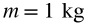 的物块静止在倾角 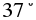 的固定斜面上。物块与斜面间的动摩擦因数 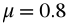，最大静摩擦力等于滑动摩擦力。取 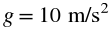，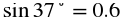，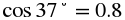。求斜面对物块的摩擦力大小和方向。

### 配图

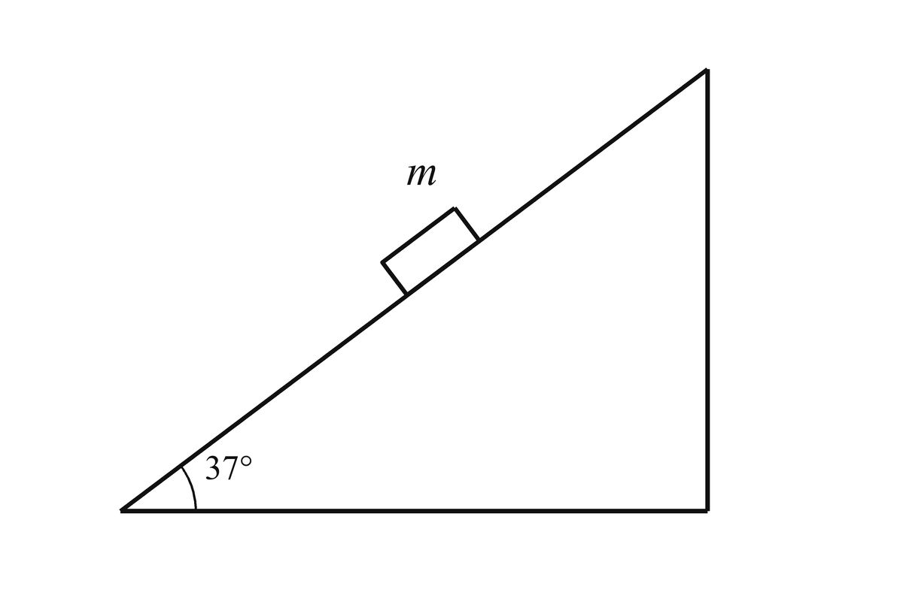

*物块静止在倾角 37° 的固定斜面上。*

## 答案

，方向沿斜面向上。

单位：N

**检验：** 重力沿斜面向下的分力为 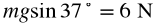；最大静摩擦力为 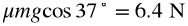。因为 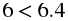，物块静止，静摩擦力与下滑分力平衡，故 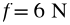，方向沿斜面向上。

*答案置信度：high*

## 解析

1. 对物块受力分析：重力 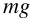、支持力 、静摩擦力 。
2. 沿斜面方向，重力分力为 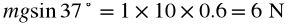，方向沿斜面向下。
3. 垂直斜面方向，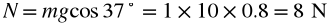，最大静摩擦力 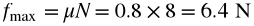。
4. 因为 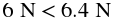，物块保持静止，静摩擦力与重力分力平衡：，方向沿斜面向上。

### 关键点

- 静摩擦力由平衡条件决定，不能用 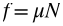 直接计算
- 先判断物体是否静止，再选择静摩擦或滑动摩擦

### 易错点

- 直接用 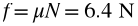，把最大静摩擦力当成实际静摩擦力
- 把静摩擦力方向判断为沿斜面向下

## 错因诊断

**学生答案：** 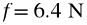，方向沿斜面向下。

**错误类型：** 模型/受力/结构、图形理解

**根因：** 没有先判断物块是否静止，直接把最大静摩擦力当成实际静摩擦力，并把方向判断反了。

**改进：** 先算重力沿斜面的分力和最大静摩擦力，比较两者大小；再由相对运动趋势确定静摩擦力方向。

## 知识点与标签

- 共点力平衡
- 静摩擦力
- 标签：斜面, 静摩擦力, 平衡
- 难度：★★☆☆☆

## 变式

若 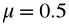，物块是否仍能静止？请说明理由。

2026-01-01
