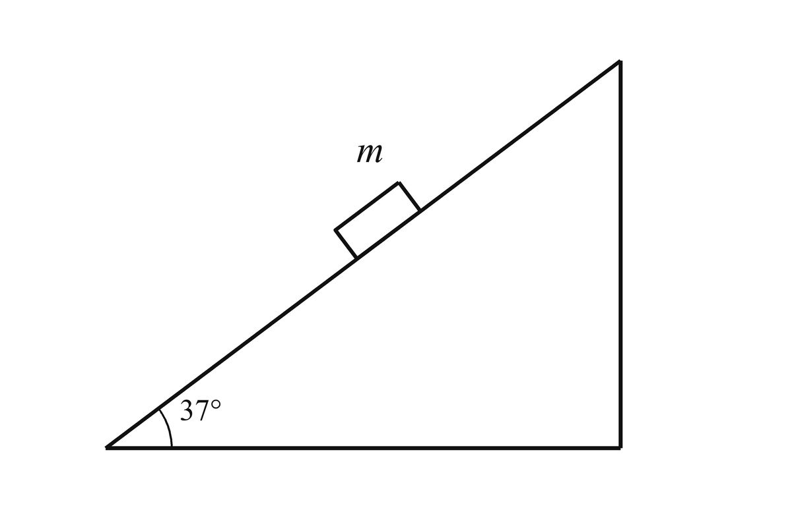

# 高中一年级 · 题目

质量 $m=1\ \text{kg}$ 的物块静止在倾角 $37^\circ$ 的固定斜面上。物块与斜面间的动摩擦因数 $\mu=0.8$，最大静摩擦力等于滑动摩擦力。取 $g=10\ \text{m/s}^2$，$\sin37^\circ=0.6$，$\cos37^\circ=0.8$。求斜面对物块的摩擦力大小和方向。

*物块静止在倾角 37° 的固定斜面上。*
